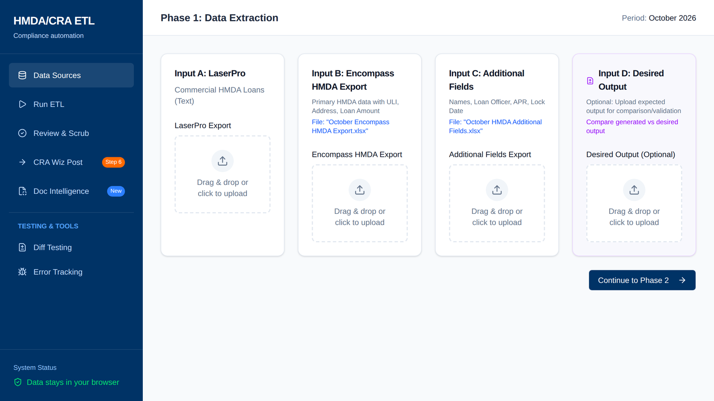

# HMDA/CRA Compliance ETL

**A bank's monthly mortgage compliance reporting run, cut from 8 to 10 hours of manual work to under 30 minutes.**

[Live demo](https://gabbyignacio7.github.io/hmda-cra-compliance-etl/) · Runs entirely in the browser · Synthetic data only



## The problem

US lenders report every mortgage application under the Home Mortgage Disclosure Act (HMDA) and the Community Reinvestment Act (CRA). At a community bank, that data lives in two or three systems that do not agree on column names, formats or record keys. Every month a compliance analyst exported each system, renamed headers by hand, stitched the files together with VLOOKUPs, fixed codes the regulator would reject, and reshaped everything into the 128-column layout the reporting software (CRA Wiz) imports.

It took 8 to 10 hours every month, and every manual step was a chance for an error that shows up later in a regulatory exam.

## What this does

Upload the exports, click Process, download a CRA Wiz-ready file.

| | Before | After |
|---|---|---|
| Monthly run | 8 to 10 hours | Under 30 minutes |
| Merge and reformat, per run | 30 to 60 minutes of VLOOKUPs | Under 5 minutes |
| Header mapping | By hand, every month | 200+ field name variants mapped automatically |
| Validation | Found during scrub or exam | HMDA code checks and auto-corrections before export |

## How it works

A seven-stage pipeline, each stage its own typed module with unit tests:

```
LaserPro / Compliance      Encompass HMDA        Encompass Additional
Reporter (pipe TXT)        export (Excel)        Fields (Excel)
        │                        │                       │
        ▼                        ▼                       │
  1. PARSE        auto-detect format and delimiter       │
  2. NORMALIZE    map 200+ field name variants           │
  3. MERGE        join on ULI / application number ◄─────┘
                  (replaces the manual VLOOKUPs)
  4. DEDUPLICATE  drop repeat ULIs across sources
  5. TRANSFORM    128-column CRA Wiz layout, branch lookup,
                  loan term to years, RateType and Var_Term
  6. VALIDATE     HMDA code validation, auto-correct common issues
  7. EXPORT       Excel / tab-delimited, ready for import
```

Details that came out of review with the compliance team:

- **Half-year rounding.** Loan_Term and Var_Term convert months to years. A remainder over 6 months rounds up, 6 or under rounds down (30 mo → 2, 43 mo → 4). Variable terms of 6 months or less round up to 1 year, the minimum reportable term.
- **Branch from the ULI.** When no branch column exists, the branch number is read from the three digits after the 20-character LEI, then checked against the branch list.
- **Geocoding left to CRA Wiz.** County and census tract are left blank on purpose so the reporting software geocodes them.

## What I owned

I ran this end to end as the product manager. I turned the analysts' manual scrub procedure into a field-level spec, then built a diff test that compares the generated file against the one the team produced by hand. I used AI coding tools to get a working version in front of the compliance team fast. After that I hardened it with typed ETL modules, 30 unit tests, linting, type-checking and CI. The rounding rules and edge cases above changed in response to the team's review.

## Run it

```bash
git clone https://github.com/gabbyignacio7/hmda-cra-compliance-etl.git
cd hmda-cra-compliance-etl
npm install
npm run dev        # local app
npm run test:ci    # unit tests
npm run build      # production build
```

Sample files for every supported input are in [`client/public/test_data`](client/public/test_data) and [`client/public/sample_data`](client/public/sample_data).

## About this repo

This tool was first built for a US community bank's compliance team. The public version uses a fictional institution: the branch list, loan officers, borrowers and loan records are all synthetic. No customer data, staff data or institution-specific configuration is included.

**Stack:** React, TypeScript, Vite, Tailwind, shadcn/ui, SheetJS, Vitest, ESLint, Prettier, GitHub Actions.

**Docs:** [Architecture](docs/ARCHITECTURE.md) · [Setup](docs/SETUP_GUIDE.md) · [User manual](client/public/USER_MANUAL.md)

Shared as a portfolio piece. All rights reserved.

Built by [Gabriel Ignacio](https://7thfloorventures.com), 7th Floor Ventures.
